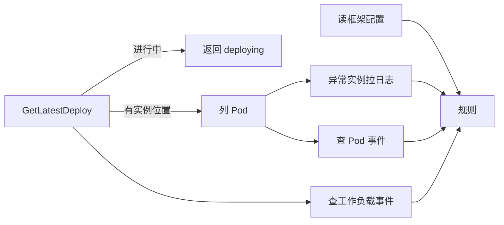
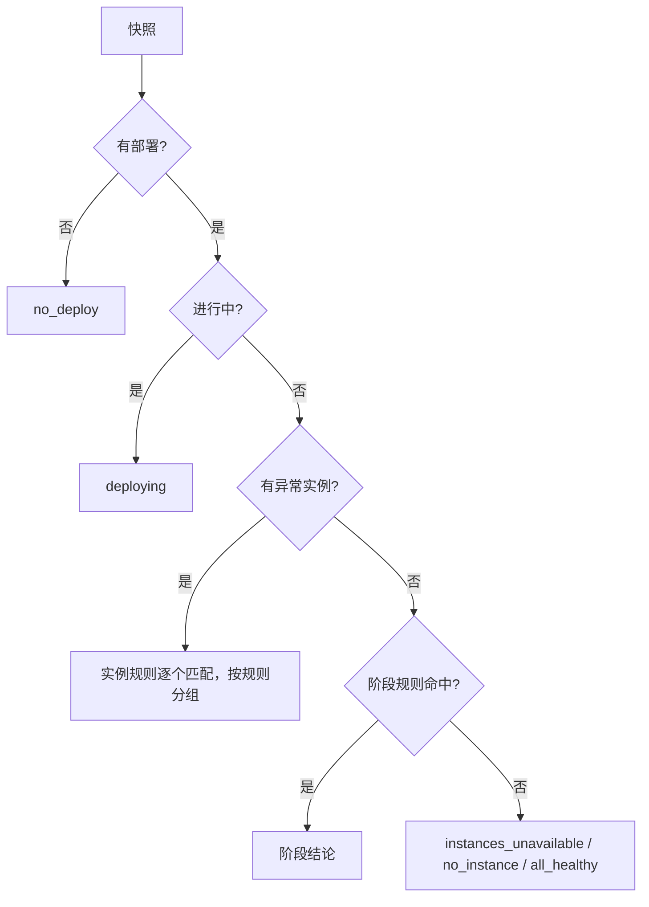

# 部署诊断

## 1. 背景

部署失败或实例起不来时，用户要在部署记录、实例列表、日志、事件之间来回切换才能定位原因。部署诊断把这些数据一次聚合，按规则给出「出错原因 + 处理步骤 + 跳转按钮」，Web 部署页面板和 CLI 共用同一个接口。

接口：`GET /v1/apps/{appID}/envs/{envName}/deploy-diagnosis?trafficLaneName=`，权限与实例列表一致（应用查看权限）。

## 2. 诊断对象：最新一次部署

诊断对象固定为该环境（泳道）最新一次部署，接口不接收 deployID：

- 面板与 CLI 的诉求都是「现在这个环境为什么不正常」，正在运行的实例只属于最新一次部署，诊断历史部署拿不到对应的实例和日志
- 「最新」的判定复用 `DeployStatusService.GetLatestDeploy`，与部署入口展示的状态口径一致

`GetLatestDeploy` 对 AppModel 应用会同时比较一键构建部署记录与 AppModel 部署记录，取新的一条：

| 最新记录 | 状态来源 | 实例位置（集群 / 命名空间 / 标签选择器） |
|---|---|---|
| AppModel 部署记录 | 部署记录 | 该部署记录 |
| 一键构建部署，已进入部署阶段 | 构建部署记录（与部署记录同步） | 关联的部署记录 |
| 一键构建部署，停在构建阶段 | 构建部署记录 | 上一次部署记录；从未部署过则没有 |
| Helm 部署记录 | 部署记录 | 只有集群和命名空间，没有标签选择器 |

各类记录的状态取值不统一（如 `polling-timeout` 与 `pollingTimeout`），统一归一成 `phase`：`inProgress` / `succeeded` / `failed` / `other`，诊断只看 `phase`。

## 3. 采集

- 实例：按实例位置列 Pod，投影口径与实例列表一致（复用 `AppInstanceOutputObj.FromPodManifest`），健康判定也一致。列 Pod 失败时整个请求失败，因为没有实例就无法给出任何实例级结论
- 日志：只给重启次数最高的前 5 个异常实例并发拉取，每个实例取末尾 200 行；有重启时优先取重启前日志，它最能说明进程为什么退出
- 事件：只取本次部署开始后的事件，Pod 事件与工作负载事件分两次查询，避免工作负载事件占满第一页把 Pod 事件挤掉。Pod 事件挂到对应实例，工作负载事件（副本创建失败、配额不足、被 webhook 拦截等）挂到分组
- 框架配置：带框架配置文件能力（`mods.Of(app).FrameworkFile`，即 tRPC / TAF 框架）的应用，从唯一的 framework 配置文件定义读取文件名和挂载目录，从 AppModel 读取启动命令，用于和日志里的读取路径比对

日志或事件失败不中断诊断，失败或被截断的数据源写入 `partialReasons`（`logs` / `events`），前端据此提示「部分证据未取到」，与「确实没有日志 / 事件」区分开。

已知局限：框架配置读的是应用当前配置，不是该次部署的资源快照。配置已修改但尚未重新部署时，路径比对可能与正在运行的实例对不上。

## 4. 规则

规则只读采集好的快照，不访问存储或集群，便于单测覆盖。

部署进行中不做诊断：滚动更新中的 Pending / ContainerCreating 实例会被判为异常，此时给结论只会误导。

### 4.1 实例规则

对每个异常实例按顺序匹配，第一条命中即停；同一规则命中的实例合并成一组，组内按重启次数降序。

| ruleId | 含义 | 命中条件 |
|---|---|---|
| `framework-config-not-found` | 框架配置文件读取失败 | tRPC / TAF 应用，日志中有「文件不存在」且路径指向框架配置文件 |
| `unknown` | 未识别的异常状态 | 兜底，恒命中，必须放最后 |

`framework-config-not-found` 的处理步骤按日志中读取路径的形态区分：相对路径（根因是工作目录）、绝对路径但与配置不一致、抽不到路径。

### 4.2 阶段规则

没有异常实例时才运行：

| ruleId | 含义 | 命中条件 |
|---|---|---|
| `build-failed` | 构建失败 | 一键构建部署在构建阶段失败 |
| `deploy-failed` | 未识别的部署失败 | 部署失败（含轮询超时、轮询中断），且不是构建阶段 |

### 4.3 新增规则

1. 在 `rules` 包实现 `InstanceRule` 或 `StageRule`：`Diagnose` 未命中返回 nil，命中时返回分组；同一规则可按分支给出不同的说明和处理步骤
2. 文案写进 `rules/messages.go`，不要散落在规则实现里；文案会同时出现在 Web 和 CLI，不要依赖界面布局（如「下方日志」）
3. 加入 `InstanceRules` / `StageRules`，注意顺序：越具体越靠前，`UnknownRule` 保持最后
4. `ruleId`、`categoryId`、按钮 `id` 是前端映射与埋点维度，发布后不要修改取值

## 5. 响应结构要点

- `emptyReason`：`groups` 为空时的空态，取值 `no_deploy` / `deploying` / `all_healthy` / `no_instance` / `instances_unavailable`；有结论时为空字符串
- `deploy`：`deployID` 指向实例所属的部署记录（用于查看资源 YAML），构建阶段失败时它是上一次部署；`buildID` / `stage` 只在一键构建部署时有值
- `groups[].categoryId` 是分类标识，`category` 是展示文案
- `groups[].actions[].id`：`frameworkConfig` / `deployConfig` / `buildHistory` / `redeploy`，前端按取值决定跳转。重新部署按钮始终下发，权限由部署入口自身校验
- 所有数组字段在没有数据时输出 `[]` 而不是 `null`
