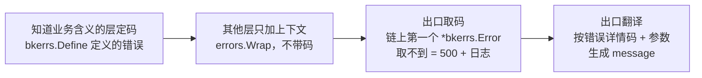

# 错误处理优化及 i18n 方案

> 状态：待评审　|　范围：bkms-server（`pkg/common/bkerrs`、`pkg/store`、`pkg/common/i18n`）、bkms-cli；前端 bkms-ui 不在本次范围内

## 概要

bkms-server 的错误响应有两个问题。一是用户输入错误经常返回 500，例如创建端口池时两个条目重名，前端收到的是 500。二是 `message` 直接返回英文错误链，用户看不懂，其中还混着 mongo 报错、集合名等内部信息，也没法翻译。

出口取码的规则本身没有问题，问题出在错误码在哪里确定。原来的约定是由 handler 统一定错误码，下层只返回普通错误；而 `bkerrs.Wrap` 把“补充上下文”和“定错误码”绑在一个接口上，handler 只想补一句上下文也得填一个码，结果多数填成 500，还会盖掉下层已经定好的码。

本方案做三件事：

1. 错误码由第一个知道业务含义的层确定，用新增的 `bkerrs.Define` 定义带码的错误；其他层只用 `errors.Wrap` 补充上下文。迁移完成后删除 `bkerrs.Wrap`。
2. `Define` 定义的错误都带一个错误详情码，出口用它查翻译表，按请求语言生成 `message`。原始的英文错误链移到 `details[0].message`，排查信息不丢。
3. store 的“不存在”“已存在”两类通用错误，由出口统一返回 404 / 409，不需要为每个集合单独定义。

响应结构不变。对前端和 CLI 的影响有两点：`message` 变成按语言翻译的文案；一批原来笼统返回 400 或 500 的接口，改为按错误的实际含义返回状态码。完整清单见第五节。依赖 `message` 文本做判断的调用方，需要改为判断 `details[0].code`。

当前进度：`Define`、i18n、出口改造和各模块的迁移已完成，正在评审；剩余 434 处 `bkerrs.Wrap(..., ErrCodeInternal*)` 的机械替换、CLI 发送语言头等工作待实施，见第六节。

文中“定码”指确定一个错误对应哪个错误码（进而决定 HTTP 状态码）；“改判”指外层把下层已定的码改成另一个码。

## 一、原有设计

### 1.1 整体结构

> 插图：原有错误处理设计概览

一个请求出错时，错误按四个阶段流转：

1. service、store 等下层用 `pkg/errors` 产生普通错误，逐层补充上下文，不带错误码。
2. handler 用 `bkerrs.New` / `Errorf` / `Wrap` / `Wrapf` 定一个错误码，这四个函数都必须传码；再调用 `AbortWithErr` 交给出口。
3. `ErrorHandler` 中间件调用 `WriteError`，从错误链上取第一个 `*bkerrs.Error` 的错误码和详情，取不到时返回 500 `INTERNAL_ERROR`，`message` 使用 `err.Error()`。
4. 按蓝鲸 HTTP API 协议输出 `{"error": {code, message, system, module, details}}`，响应头附带 `X-Trace-Id`。

错误码共 13 个，由 `ErrCode.AsHTTPStatusCode()` 集中映射到 HTTP 状态码。`details` 中的错误详情码供前端做定制提示，例如无 IAM 权限时引导用户申请。

### 1.2 做得好的部分

> 插图：原有设计的优点与保留

整体框架是合理的，本方案基本保留：

- handler 不直接写错误响应，统一由出口输出，前端 `fetch.ts` 和 bkms-cli 只需解析一种格式。
- 业务代码只选择错误码，不写 HTTP 状态码。
- 出口用 `errors.As` 取链上第一个带码错误。这是标准库语义，Kratos、Kitex、Goa 也是这样做的。
- 没有分类的错误兜底返回 500，不会出现 200 或空响应。
- `details` 支持结构化详情；调用栈与 `pkg/errors` 兼容，`%+v` 能打印完整错误链。
- 鉴权模块通过标记接口声明“未认证”，不依赖 bkerrs 的具体错误码。本方案把这个思路推广到 store 的错误类别（见 3.4）。原来的未认证分支在仓库中没有任何实现方，已删除。

### 1.3 存在的问题

> 插图：原有设计存在的问题

以创建端口池时两个条目名称重复为例。这是用户输入错误，应该返回 400，实际调用链如下：

| 步骤 | 写法 | 代码位置（改造前） |
| - | - | - |
| service 校验条目名称唯一 | `errors.Errorf("poolItem itemName %s already exists", ...)`，不带码 | `portpool/service.go` 第 216-225 行 |
| service 补充上下文 | `errors.Wrap(err, "validate portpool")` | 同文件第 73-75 行 |
| handler 定码 | `bkerrs.Wrap(err, ErrCodeInternalServerError, "create portpool config")` | `portpool/handler/portpool.go` 第 128-129 行 |
| 出口 | 取到 500，`message` 使用 `err.Error()` | `bkerrs/gin.go` 第 81-99 行 |

前端收到：

```json
HTTP 500
{"error": {"code": "INTERNAL_SERVER_ERROR",
  "message": "create portpool config: validate portpool: poolItem itemName a already exists"}}
```

这个例子里的问题在全项目普遍存在：

1. **外层的码盖掉内层的码。** 即使下层用 `bkerrs.New` 定了 `ALREADY_EXISTS`，handler 再用 `bkerrs.Wrap` 包一次，出口取到的仍是外层的 500。`pkg` 下有 410 处 `Wrap(err, ErrCodeInternal*, ...)`。
2. **反过来，也有 handler 一律包成 400。** 数据库超时这类系统故障也返回 400，下层定的 409 同样被盖掉，例如 `core/env/handler/env.go` 第 125 行、`workload/networking/handler/networking.go` 第 100 行。
3. **handler 只能猜错误类型。** handler 靠一串 `errors.Is` 判断下层返回了什么。下层每新增一种业务错误，所有调用方都要补判断，漏一处就是 500。例如 `ErrEnvAlreadyExists` 在业务代码中没有任何地方判断。
4. **用户看到的是给开发者看的错误链。** 里面有内部信息，而且无法翻译。
5. **多次包装会丢掉 details。** 例如 IAM 无权限时附带的用户组信息被上层 `Wrap` 冲掉，前端无法引导用户申请权限。
6. **出口不打日志。** 500 的完整错误链只出现在响应体中，服务端难以排查。

根因有三条：

- **约定让 handler 定码，`Wrap` 又要求加上下文时必须定码。** 加上下文是每一层都会做的事，定码在一条链上只需要一次，两件事绑在同一个接口上，外层随手填的码就会盖掉内层的（问题 1、2、5）。
- **下层没有好用的带码写法。** `var ErrX = bkerrs.New(...)` 虽然能当哨兵错误用，但调用栈记录的是包初始化的位置，`SetDetails` 会修改共享的全局变量，参数也只能拼进字符串。所以项目里没人这样用，领域错误都是不带码的 `errors.New`，只能交给 handler 补码（问题 3）。
- **给用户的文案和给开发者的错误链共用 `Error()` 一个输出。** 没有独立的文案字段和结构化参数，翻译无处接入（问题 4）。

问题 6 是出口实现上的遗漏，和接口设计无关，改造出口时一并补上。

## 二、目标

要做到：

- 重名、参数非法、状态不允许这类业务错误，返回 4xx 和稳定的错误码。
- `message` 按请求语言（中文、英文）翻译，并能带参数，例如“端口池条目名称 a 重复”。
- 定码和加上下文彻底分开。最终删除 `bkerrs.Wrap`，混用时直接编译不过。
- 漏掉分类的错误能被发现：返回通用文案，同时记录日志。

不做：复数形式、日志翻译、前端文案国际化、翻译热更新。

## 三、方案

### 3.1 规则



**第一个知道错误业务含义的层定码，且只定一次。** 定码使用 `Define` 定义的错误：用 `With` 附加参数，用 `WithCause` 挂上原因。这一层通常是 service，也可以是 handler。工具函数、k8s 客户端封装、解析器、store 这类通用组件不知道自己被用在什么场景，不定码。

**其他层只补充上下文。** 用 `errors.Wrap` 或 `fmt.Errorf("%w")`，不带码。

**用户文案和错误链分开。** 用户看到的 `message` 按错误详情码翻译；错误链只进日志和 `details`。

出口的取码规则不变，仍然取链上第一个 `*bkerrs.Error`。外层需要改判时，显式新建一个错误并用 `WithCause` 挂上原错误，新错误自然排在链的最前面，不需要额外的优先级规则。

知道业务含义的层不一定是最底层。同一个底层错误在不同场景下应该返回不同的状态码，只有外层能判断：

| 底层错误 | 场景 | 应返回 |
| - | - | - |
| 端口池 `ErrConfigNotFound` | `GET /port-pools/{name}`，名称来自 URL | 404 |
| 同上 | 更新流程中刚从列表查到，再取详情时却不存在 | 500（数据不一致或并发删除） |
| 环境不存在 | 请求体引用了不存在的 `envID` | 400 |
| k8s `Upsert` 返回 422 | manifest 中的端口范围由用户填写 | 400 |
| 同上 | manifest 由代码拼装 | 500 |
| `ParseImage(s)` 失败 | `s` 来自用户输入 / 来自数据库 | 400 / 500 |

这类情况下，下层返回普通错误或普通哨兵错误（如 `k8sclient.ErrResourceNotFound`），由外层判断后定码。

### 3.2 bkerrs 的接口与用法

```go
// Error 是唯一的带码错误类型
type Error struct {
	code       ErrCode           // 标准错误码，映射 HTTP 状态码
	detailCode ErrDetailCode     // 错误详情码：稳定的机器可读键，同时是翻译 key，输出为 details[].code
	msg        string            // 给开发者看的英文描述
	params     map[string]string // 文案参数，输出为 details[].extras
	cause      error
}

// Define 在错误产生的包里定义错误，并登记到全局目录，用于检查详情码重复和翻译是否齐全
func Define(code ErrCode, detailCode ErrDetailCode, msg string) *Error

// With 复制一份并附加一个文案参数，可链式调用
func (e *Error) With(key, value string) *Error

// WithCause 复制一份并挂上原因，用于外层改判
func (e *Error) WithCause(cause error) *Error

// Is 按 code + detailCode 比较，派生出的实例与定义互相匹配
func (e *Error) Is(target error) bool

func (e *Error) Unwrap() error
func (e *Error) Error() string // msg + 参数 + ": " + cause.Error()，只给开发者看

// FromError 取错误链上第一个 *Error，取不到返回 nil
func FromError(err error) *Error
```

三种基本操作：

```go
// 定码：在错误产生的包里定义一次，返回时附带参数
var ErrItemNameDuplicated = bkerrs.Define(
	bkerrs.ErrCodeInvalidArgument, "PORTPOOL_ITEM_NAME_DUPLICATED", "portpool item name duplicated")

return ErrItemNameDuplicated.With("itemName", name)

// 加上下文：任何一层都可以，不带码
return errors.Wrapf(err, "create portpool %s", cfg.Name)

// 改判：刚从列表查到的端口池再取详情时不存在，说明数据不一致，应返回 500 而不是 404
if errors.Is(err, portpool.ErrConfigNotFound) {
	return ErrDataInconsistent.With("portpool", name).WithCause(err)
}
```

1.3 中的端口池例子按新写法改造后，service 直接返回 `ErrItemNameDuplicated.With("itemName", item.ItemName)`，中间层和 handler 都只用 `errors.Wrap` 补上下文。出口取到 service 定的 `INVALID_ARGUMENT`，返回：

```json
HTTP 400
{"error": {"code": "INVALID_ARGUMENT",
  "message": "端口池条目名称 a 重复",
  "details": [{"code": "PORTPOOL_ITEM_NAME_DUPLICATED", "extras": {"itemName": "a"},
               "message": "create portpool config: validate portpool: portpool item name duplicated (itemName=a)"}]}}
```

再看 handler 猜错误类型的情况。改造前，service 返回不带码的 `errors.New("portpool config not found")`，handler 用 `errors.Is` 判断后改写成 404，其余错误一律 500。改造后，哨兵错误本身就带码，handler 只补上下文：

```go
// service
ErrConfigNotFound = bkerrs.Define(bkerrs.ErrCodeNotFound, "PORTPOOL_NOT_FOUND", "portpool config not found")
return ErrConfigNotFound.With("name", name)

// handler
bkerrs.AbortWithErr(c, errors.Wrapf(err, "update portpool config %s in env %s", name, envID))
```

`Define` 返回的仍是包级变量，上层需要区分时照样可以用 `errors.Is`。

**什么时候用 Define。** 用户可能触发、需要返回 4xx 或特定提示的业务错误，例如重名、参数不合法、状态不允许、资源不存在；以及上层需要用 `errors.Is` 区分处理的业务错误。数据库超时、外部系统调用失败这类系统故障不需要，保持普通错误，出口会按 500 处理并记日志。新增 `Define` 时，同时在 `pkg/common/i18n/locales/` 中补充这个详情码的中英文文案。

**handler 什么时候定码。** 并不禁止 handler 定码。handler 是知道业务含义的那一层时，就应该由它定码，典型情况有两种：下层返回的是普通错误，只有 handler 知道它在当前接口里意味着什么（例如解析失败的字符串来自请求体）；或者下层已经定了码，但在当前接口里含义不同。handler 定码时要先用 `errors.Is` / `errors.As` 判断出具体错误，只对这一种错误用 `Define` 的错误 + `WithCause` 改判，其他错误原样补上下文后返回：

```go
if errors.Is(err, portpool.ErrConfigNotFound) {
	bkerrs.AbortWithErr(c, ErrDataInconsistent.With("portpool", name).WithCause(err))
	return
}
bkerrs.AbortWithErr(c, errors.Wrap(err, "update portpool config"))
```

改判后，`details` 中仍保留下层的完整错误链，`errors.Is(err, portpool.ErrConfigNotFound)` 也仍然成立。这和改造前无条件调用 `bkerrs.Wrap(err, code, ...)` 的区别在于：`Wrap` 对所有错误一律生效，会把下层定好的各种码全部盖成同一个。

**详情码写在 Define 调用处。** 详情码（如 `"PORTPOOL_ITEM_NAME_DUPLICATED"`）由各业务包自己维护，不在 `bkerrs` 中集中声明常量，否则 `bkerrs` 会随业务增长到数百个常量，每新增一个错误都要改公共包。`Define` 在启动时检查详情码是否重复，重复即 panic；建议以模块名作为前缀。`err_detail_code.go` 只保留 `NewDetail` 手工构造详情时用到的、跨包共享的详情码，例如 `IAM_NO_PERMISSION`。Kratos 也是这样做的：`Reason` 由各服务在自己的 proto 中定义。

**专用工具函数。** `WrapAPMConfigMissing`、`WrapBuildLogUnavailable` 等已改为基于 `Define` 实现，原有的详情和 extras 保留。`WrapIAMNoPermission` 需要查询权限中心用户组，留在 `bkerrs` 会让它依赖 `perm → bkiam → store → auth / tenant`，导致 auth、tenant 中间件无法使用 `bkerrs`，因此移到了 `pkg/infras/perm`。

### 3.3 为什么需要 Define

如果只想解决错误码被覆盖的问题，其实不需要新接口：在产生处用 `bkerrs.New` 定码，其余层改用 `errors.Wrap` 就行。5xx 返回通用文案、出口不再返回整条错误链，也都和 `Define` 无关。

`Define` 要解决的是具体业务提示的翻译。要把“端口池条目名称 a 重复”翻译出来，出口需要两样东西：一个能查翻译表的 key，和结构化的参数。`bkerrs.New` 把参数拼进了英文字符串，这两样都拿不到。

和 `var ErrX = bkerrs.New(...)` 这种写法相比，`Define` 补上了以下几点：

| | `var ErrX = bkerrs.New(...)` | `Define` |
| - | - | - |
| 调用栈 | 记录在包初始化处，看不出在哪里返回 | `With` / `WithCause` 每次派生时记录返回处 |
| 附加信息 | `SetDetails` 修改共享的全局变量，并发时互相污染 | 每次派生都是副本，定义本身不变 |
| 参数 | 只能拼进字符串 | 单独保存，用于翻译和输出 `details[].extras` |
| 详情码 | 每次返回都要手动 `SetDetails(NewDetail(...))` | 定义时声明一次 |
| 详情码重复、漏写翻译 | 无从发现 | 重复时启动 panic；测试遍历登记目录检查翻译 |

也考虑过 gettext 的做法：不定义详情码，直接把英文原文模板当翻译 key，例如 `bkerrs.New(code, "Port pool item name {{.itemName}} is duplicated").With("itemName", name)`。它的写法最接近现有代码，但没有采用，原因是：改一个字翻译就会失效，而且不会报错；文案散落在各个调用处，没有登记目录，无法在启动或测试时检查是否漏翻；前端仍然拿不到稳定的机器可读码；每次调用都产生新实例，也不能当哨兵错误做 `errors.Is` 判断。

### 3.4 store 的通用错误

store 是通用组件，不依赖 `bkerrs`，也不知道错误码。它内置了两个通用哨兵错误 `store.ErrNotFound` 和 `store.ErrDuplicate`，各集合 `Meta` 中配置的 `NotFound` / `Duplicate` 都能与它们 `errors.Is` 匹配。项目中约有 49 个集合配了 NotFound、25 个配了 Duplicate，逐个 `Define` 不现实。

做法是让 store 的错误声明自己属于哪一类，由出口按类别统一定码：

```go
// store：哨兵错误与 storeError 实现标记方法，不引用 bkerrs
func (e *genericError) IsNotFound() bool      { return e.notFound }
func (e *genericError) IsAlreadyExists() bool { return e.alreadyExists }

// bkerrs 出口：链上没有 *Error 时，按顺序匹配错误类别
var declaredCategories = []struct {
	declares func(error) bool
	def      *Error
}{
	{declaredBy(notFoundError.IsNotFound), Define(ErrCodeNotFound, "RESOURCE_NOT_FOUND", "resource not found")},
	{declaredBy(alreadyExistsError.IsAlreadyExists), Define(ErrCodeAlreadyExists, "RESOURCE_ALREADY_EXISTS", "resource already exists")},
}
```

| store 错误 | 声明的类别 | 错误码 | 详情码 | 文案 |
| - | - | - | - | - |
| `store.ErrNotFound` | `IsNotFound()` | `NOT_FOUND`（404） | `RESOURCE_NOT_FOUND` | 资源不存在 / Resource not found |
| `store.ErrDuplicate` | `IsAlreadyExists()` | `ALREADY_EXISTS`（409） | `RESOURCE_ALREADY_EXISTS` | 资源已存在 / Resource already exists |

新增类别时，声明一个标记接口，并在表中追加一项即可。

之所以用标记方法，而不是让 store 直接返回带码错误，是因为错误码属于传输层的分类，store 作为基础设施不应该依赖它；而且 `bkerrs` 经由 `perm` 间接依赖 store，反向依赖会形成循环。标记方法只表达“不存在”“已存在”这层语义，两边互不引用，也不需要全局登记表。Kubernetes 的思路相同：通用存储错误只分少量类别，不按资源逐个定义。

按类别定码的优先级最低：只要错误链上已经有 `*bkerrs.Error`，就以链上的为准。所以 `Meta` 配置了 `Define` 定义的错误（如 `envmodel.ErrEnvAlreadyExists`）、外层用 `WithCause` 改判、尚未迁移的 `bkerrs.Wrap`，这几种情况都不受影响。它也不改变错误链本身，业务代码里用 `errors.As` / `bkerrs.FromError` 取错误码的逻辑（如 `devmode/handler/restart.go` 的 `isSkippableRestartErr`）行为不变。

另外两点约定：

- `storeError.Unwrap()` 改为返回 `[]error{domain, cause}`。改造前只返回底层 mongo 错误，`Meta` 中配置的领域错误在错误链上不可见。
- store 不知道业务参数。文案里需要带资源名称时，由 service 改判：`ErrEnvAlreadyExists.With("name", name).WithCause(err)`。

“不存在”默认返回 404 有一个代价：内部查询查不到数据时，如果忘了改判，会误报 404。反过来，如果默认保持 500，大量按 URL 查资源的 GET 接口都要手动改判。bkms 中按 URL 参数查资源是主要场景，所以选择默认 404；出口对 404 记录 warn 日志，误报可以从日志中统计出来。

也考虑过在组装处（`pkg/server`）用 `init` 登记“哨兵错误到带码错误”的映射表。它能映射任意哨兵，包括第三方库的错误，但规则和错误定义分离、依赖全局状态，而且只在导入了 `pkg/server` 的二进制中生效。目前只有 store 需要按类别定码，而 store 由本仓库维护，所以没有采用。以后如果需要对第三方错误按类别定码，可以在客户端封装层包一个实现了标记方法的错误。

### 3.5 国际化

i18n 是自研的轻量实现，约 100 行：用 `go:embed` 内嵌 YAML 资源，加载成 map 查表；用标准库 `text/template` 渲染命名参数；用 `x/text/language` 做语言协商。没有用 go-i18n / gin-contrib/i18n，因为它们的附加价值在复数处理和文案提取工具，这里用不到；golang-gin-template-v2 评审（MR !63）时也因为“需预定义 Message、设计过重”放弃了它们。`x/text` 的 `catalog` 只接受位置参数，查不到 key 时原样输出，难以判断要不要回退，也没有采用。调用方只通过 `i18n.Localize` 访问，以后需要复数、本地化数字格式时可以替换底层实现。

```
pkg/common/i18n/
├── i18n.go          # 加载、查表、渲染
├── lang.go          # 支持语言列表、协商、ctx 存取
├── middleware.go    # Gin 语言中间件
├── locales/         # go:embed 内嵌，按模块分文件
│   ├── errors.yaml  # bkerrs 自身：错误码通用文案、RESOURCE_* 类别文案、内置工具函数文案
│   ├── core_app.yaml / core_env.yaml / core_workspace.yaml
│   ├── workload.yaml / deploy.yaml / build.yaml / extension.yaml
│   └── observability.yaml / bkintegrations.yaml / platmgt.yaml / misc.yaml / infras.yaml / server.yaml
└── i18n_test.go
```

一个 key 在同一个文件里同时写中英文。错误文案的 key 是详情码或错误码，大写加下划线；非错误的展示文案用小写点分的 key。

```yaml
INVALID_ARGUMENT:
  zh: "参数错误"
  en: "Invalid argument"
PORTPOOL_ITEM_NAME_DUPLICATED:
  zh: "端口池条目名称 {{.itemName}} 重复"
  en: "Port pool item name {{.itemName}} is duplicated"
```

```go
// Localize 按 ctx 中的语言渲染文案，key 不存在或缺少模板所需参数时返回 false
func Localize(ctx context.Context, key string, params map[string]string) (string, bool)

// LocalizeOr 渲染失败时返回 fallback，用于枚举名称、内置变量说明等代码中的固定展示文本
func LocalizeOr(ctx context.Context, key string, params map[string]string, fallback string) string

// LocalizeStored 翻译系统写入存储的默认文案：stored 与 key 的中文文案一致（未被用户修改）时按请求语言渲染，否则原样返回
func LocalizeStored(ctx context.Context, key string, params map[string]string, stored string) string

// Has 判断 key 是否有对应的文案，用于翻译完整性检查
func Has(key string) bool
```

资源在启动时全部加载并校验。YAML 格式错误、某个 key 缺少任一语言的文案、模板语法错误、key 跨文件重复，都会直接导致启动失败。渲染使用 `missingkey=error`，缺参数时返回 false、走兜底文案，避免输出 `<no value>`。`i18n` 包不依赖 `bkerrs`，错误以外需要按语言返回的文案也可以直接用。

**存储中的默认文案。** 默认环境名、内置发布策略名、默认告警策略名、配置文件初始 / 回滚版本描述、APM 内置环境变量说明这些内容是系统写进数据库的。读取时按记录的稳定标识（内置项 ID、环境类型、变量 key 等）拼出 key 去翻译，翻译不到就返回存储值。为了不覆盖用户改过的内容，只有存储值和该 key 的中文文案一致时才翻译；系统写入默认值时统一使用中文文案。不做数据迁移，存储结构不变。

**语言的确定。** 语言中间件按以下优先级确定请求语言，结果写入 `ctxkey.Lang`。中间件注册为全局中间件，先于各路由组的 `bkerrs.ErrorHandler()` 执行。

| 优先级 | 来源 | 说明 |
| - | - | - |
| 1 | `blueking_language` cookie | 蓝鲸统一约定，前端已在使用 |
| 2 | `Accept-Language` | 在支持的语言中协商，能处理 q 权重以及 `zh-TW`、`en-GB` 等 |
| 3 | 默认 | 中文 |

支持的语言在 `lang.go` 中用一个列表显式声明，语言协商和加载校验都从这个列表派生。新增语言时，声明对应的 `Lang` 常量、在列表中追加一项，再为所有 key 补齐这门语言的文案，缺任何一条都会启动失败。资源随版本发布，目前没有热更新翻译或动态加载语言的需求。以后如果需要运维侧替换翻译、独立交付语言包，再参考 csdm 的做法补充外部目录加载与重载。

### 3.6 出口

```go
func WriteError(c *gin.Context, err error) {
	code := ErrCodeInternalError
	bkErr := classify(err) // 取链上第一个 *Error，取不到时按 IsNotFound / IsAlreadyExists 声明的类别转换
	if bkErr != nil {
		code = bkErr.Code()
	}
	logError(c, code, err) // 5xx 记 error（含错误链与调用栈），404 记 warn

	message, details := userMessage(c.Request.Context(), bkErr, code, err)
	c.JSON(code.AsHTTPStatusCode(), GinErrorOutput{Error: GinError{Code: code, Message: message, Details: details.AsMaps(), ...}})
}
```

顶层 `message` 和 `details` 的取值：

| 错误 | `message` | `details` |
| - | - | - |
| `Define` 定义的错误 | 按详情码和参数翻译，如“端口池条目名称 a 重复”；缺翻译或缺参数时用错误码的通用文案 | 详情码、参数和完整错误链 |
| 其他 5xx（含未分类错误） | 错误码的通用文案，如“服务内部错误”，不返回 `err.Error()` | 原有详情和完整错误链 |
| 其他 4xx（尚未迁移的存量写法） | 原始错误信息 `err.Error()`（待评审确认，见第四节） | 原有详情 |

响应格式（`code`、`message`、`details[].code`）不变，前端 `fetch.ts` 和 bkms-cli 不需要修改解析逻辑。

### 3.7 参数校验与 CLI

请求参数绑定错误集中在 `ginutils/binding.go` 处理，已统一为 `ErrInvalidRequestParams`（详情码 `REQUEST_PARAMS_INVALID`，400），`message` 为翻译后的“请求参数不合法”，校验器给出的英文原因保留在 `details` 中。后续会在这里把 `validator.ValidationErrors` 按规则（`required`、`max` 等）逐字段翻译，改一处全站生效。

bkms-cli 的 HTTP 客户端将统一按 `LC_ALL` / `LANG` 设置 `Accept-Language`，解析不到时发送 `en`，保持现在的英文输出。

## 四、决策

已确认：

- `ALREADY_EXISTS` 保持返回 409。
- 请求既没有语言 cookie 也没有 `Accept-Language` 时，默认中文。
- 原始英文错误链保留在 `details[].message`，顶层 `message` 只放翻译后的文案。
- 支持的语言在代码中用一个列表显式声明，不做动态加载和热更新。

待评审确认：

- 不是 `Define` 定义的存量 4xx 错误，在迁移到 `Define` 之前，`message` 沿用原始错误信息。这样做是为了避免存量写法的具体提示退化成“参数错误”这类通用文案。

## 五、对调用方的影响

响应结构不变，以下变化需要前端、CLI 和其他依赖方知悉。

**全局**

- 4xx 的 `message` 原来是英文的 `err.Error()`，现在按请求语言翻译，默认中文；英文原因保留在 `details[0].message`。依赖 `message` 文本做判断的调用方，需要改为判断 `details[0].code`。
- 请求参数绑定失败时，`details[0].code` 为 `REQUEST_PARAMS_INVALID`，`message` 为“请求参数不合法”。
- 原来对所有错误统一套一个 4xx 码的接口，改为先判断具体错误：判断命中的保留 4xx，其余（数据库、外部系统故障）返回 500。
- 原来没被 handler 判断的 `store.ErrNotFound` / `store.ErrDuplicate` 按 500 返回，现在分别返回 404 / 409 和通用文案。
- 系统写入的默认文案（默认环境名、内置发布策略名等）和代码中的固定展示文本（审计操作名、平台角色名、指标名称、拓扑告警、Helm / 环境变量提示等）按请求语言返回；用户改过的存储值原样返回。

**认证与租户中间件（`pkg/infras`）**

| 位置 | 改造前 | 改造后 |
| - | - | - |
| 登录态校验中间件 | 401，`message` 固定为 `unauthorized`，无 `details` | 401，`details[0].code` 为 `USER_UNAUTHENTICATED`，`message` 按语言翻译 |
| 当前用户接口（`account.GetCurrentUser`） | 未登录 401，返回 `{"login_url", "code": "1000"}`；取不到认证结果（中间件配置错误）时 400 | 未登录 401，标准错误格式，不再返回 `login_url`（前端与 CLI 均未使用）；中间件配置错误 500 |
| 账号 token 接口 | 所有错误都是 400，返回 `{"message", "code": "1000"}` | 标准错误格式；参数缺失、登录服务返回失败为 400（各自的 `ACCOUNT_*` 详情码）；未配置 `bk_login_url` 为 500 |
| 租户中间件 | 响应体只有 `{"error": {"message"}}` | 状态码不变（租户 ID 缺失或不合法 400、用户缺失 401、无权访问租户或用户被禁用 403、其他 500），改为标准错误格式并带 `TENANT_*` 详情码 |

**按模块的状态码变化**

| 模块 | 接口 / 位置 | 改造前 | 改造后 |
| - | - | - | - |
| core/env | `CreateEnv` | 400 | 重名 409，其他 500 |
| core/env | `ListEnvs`、`ListAppEnvs`、`ListFeatureEnvs` | 400 | 500（只可能是存储故障） |
| core/env | `GetEnvByName`、`UpdateEnvBasicInfo` | 400 | 环境不存在 404，其他 500 |
| core/env | `UpdateEnvCluster` | 400 | 参数问题 400、环境不存在 404、其他 500 |
| core/workspace | `ListWorkspaces`、`ListWorkspacesOverview` 的权限过滤 | 403 | 500（无权限的空间会被过滤而不是报错，出错只可能是调用权限中心失败） |
| core/app | 配置文件版本查询与回滚、配置文件定义查询 | 任何错误都是 404 | 不存在 404，其他 500 |
| workload | 环境变量列表、网络配置读写、实例列表、事件、WebConsole | 存储或外部调用错误也归为 4xx | 命中具体错误时 4xx，其他 500 |
| deploy | `helpers.go`、`helm_deploy.go` 中的应用 / 部署查询 | 任何错误都是 4xx | 命中具体错误时 4xx，其他 500 |
| build | 自动部署、镜像构建、Chart 构建与构建日志 | 任何错误都是 4xx | 命中具体错误时 4xx，其他 500 |
| extension | polaris、depservice | 少数几个笼统的码 | 拆分为具体的 `Define`，状态码按含义确定 |

## 六、进度与后续

### 6.1 迁移量

| 写法 | 改造前 | 当前 | 说明 |
| - | - | - | - |
| `bkerrs.Wrap/Wrapf(..., ErrCodeInternal*, ...)` | 410 | 434 | 阶段二机械替换为 `errors.Wrap/Wrapf`，行为不变（未分类即 500）；本次改动涉及的代码已经替换 |
| `bkerrs.Wrap/Wrapf` 搭配其他错误码 | 约 150 | 0 | 已逐个审查：外层改判的改为 `Define` + `WithCause`，本应在下层定码的下沉到产生处 |
| `bkerrs.New/Errorf` | 201 | 8 | 4xx 已全部迁移到 `Define`；剩余 6 处 5xx / 501 和 2 处 `bkerrs.go` 注释示例 |

本次迁移覆盖 core（app / env / workspace）、workload、extension、deploy、build、observability、bkintegrations、platmgt、perm、misc、infras（account / auth / tenant）和 server，共新增约 300 个 `Define` 及对应文案。非错误的展示文案（枚举名称、审计操作名、内置变量说明、拓扑告警等）也一并改为 `LocalizeOr` / `LocalizeStored`。`bkerrs/README.md` 已按新规则重写，`WithSystem` 的写法统一为 `SystemName`。

### 6.2 实施计划

| 阶段 | 内容 | 状态 |
| - | - | - |
| 一 | `Define` / `With` / `WithCause` / `FromError`；`storeError.Unwrap`；出口 5xx / 404 日志；i18n 包、语言中间件、出口翻译；资源加载校验与翻译完整性测试；store 按类别定码；README 重写；端口池、特性环境作为示范迁移 | 已实现第一版 |
| 二 | 开启 `forbidigo`、`errorlint`；434 处 `Wrap(..., ErrCodeInternal*)` 机械替换 | 待实施 |
| 三 | 审查其他错误码的 `Wrap` 和 4xx 的 `bkerrs.New/Errorf`；展示文案与存储默认值的翻译；auth / tenant / account 中间件改用 `Define`；API 用例改为断言错误码 | 已实现，待评审（影响见第五节） |
| 四 | 关键创建 / 改名接口补充 API 用例（如重复创建返回 409） | 待实施 |
| 五 | 参数校验逐字段翻译；bkms-cli 发送 `Accept-Language` | 待实施 |
| 六 | 剩余 5xx 的 `bkerrs.New/Errorf` 迁移；全部完成后删除 `Wrap` / `Wrapf`，README 删去存量写法一节 | 待实施 |
| — | 前端 bkms-ui 中硬编码的文案、依赖 `message` 文本的逻辑 | 由前端同学另行处理 |

### 6.3 防止遗漏

- **编译期**：迁移完成后删除 `bkerrs.Wrap` / `Wrapf`，带码包装的写法直接编译不过。迁移期间用 golangci-lint 的 `forbidigo` 禁止新增调用，用 `errorlint` 检查 `%v` 断链和用 `==` 比较错误（待实施）。
- **启动时**：校验每个 key 都有全部语言的文案、模板语法正确、key 不重复；详情码重复时 `Define` 直接 panic（已实现）。
- **测试**：`pkg/server` 的测试遍历 `Define` 登记目录，`bkerrs` 的测试遍历 `ErrCode` 列表，断言都有对应文案（已实现）。模板参数名和 `With` 的 key 是否一致暂未校验。API 用例已改为断言 `error.code` 和 `details[0].code`，不再断言随语言变化的 `message`；重复创建返回 409 的用例待补。
- **运行时**：最终返回 5xx 的请求记 error 日志（路由 + 错误链），用来发现漏分类的接口；404 记 warn 日志，用来发现内部查询忘了改判（已实现）。
- **可选**：扫描领域包中消息含 `already exists`、`duplicate`、`invalid`、`not allowed` 的 `errors.New` / `errors.Errorf` 并提示，可能误报，只作提醒。

原计划还有一项测试，断言有唯一索引的集合都配置了 `Meta.Duplicate`。改为出口按类别定码后，没配置时 `store.ErrDuplicate` 也会返回 409，这项测试不再需要。

### 6.4 风险

- **人工审查可能判断错。** 约 150 处带码 `Wrap` 是逐个判断后改的。按模块分批提交，每批用 API 用例回归。
- **NotFound 可能误报。** 内部依赖的数据查不到时，如果忘了改判，会返回 404。需要在外层用 `WithCause` 改判为 500，并依靠 404 warn 日志发现。
- **通用文案不够具体。** 按类别定码只能给出“资源不存在”“资源已存在”，不含资源类型和名称。需要具体提示时，在 `Meta` 中配置 `Define` 定义的错误，或在 service 中改判。
- **过渡期旧写法仍会覆盖错误码。** 未迁移的 `bkerrs.Wrap` 仍会盖住内层的码，需要按阶段二推进替换。
- **bkms-cli 过渡期显示中文。** 阶段五之前 CLI 不发送 `Accept-Language`，5xx 和 `Define` 定义的错误会返回默认语言（中文）的文案。
- **details 可能暴露内部信息。** 为了便于排查，`details` 保留了原始错误链，其中可能有集合名、过滤条件等细节。

## 附录：主流框架的做法

| 框架 | 错误码定在哪 | 有无带码包装接口 | 出口取码规则 | 用户文案与内部信息 |
| - | - | - | - | - |
| Kratos | biz 层（proto 生成） | 无，只有 `WithCause` | `errors.As` 取第一个，取不到为 500 | `Reason` + `Metadata` 机器可读 |
| Kitex | handler / biz 层 | 无 | `errors.As` 取第一个 | `code` + `msg` + `extra` |
| Goa | 设计 DSL 声明，service 层返回 | 无 | `errors.As` 取 `Name` 查声明表，未声明为 500 | `Name` 与 `Message` 分开，`Fault` 标记服务端错误 |
| Kubernetes | registry（通用存储层）翻译为 `NewAlreadyExists` 等 | 无 | `errors.As` 取第一个 `APIStatus` | `Reason` + `Details` |
| WTF 示例（Ben Johnson） | 领域 / service 层 | 无，用 `%w` | `errors.As` 取第一个，取不到为 500 并记日志 | 内部错误只显示 "Internal error" |
| Gin / go-zero | 不管，交给中间件 / 全局钩子 | 不涉及 | 使用者自定义 | Gin 区分 Public / Private |
| Beego（反例） | 任意层 | 有，必须带码 | 解析字符串前缀，外层优先 | 不分开 |

主流框架都没有“带码包装”接口，只有 Beego 的 `berror.Wrap` 采用“带码包装、外层优先”的设计，也有和 bkms 改造前一样的覆盖问题。本方案的借鉴来源：

- **Kratos**：错误结构（code + reason + 参数 + cause），先定义再派生，`Is` 按 reason 比较。Kratos 的 `Reason` 对应 bkms 已有的错误详情码 `ErrDetailCode`，为与现有命名一致，字段叫 `detailCode`。
- **Kubernetes**：通用存储层的错误只分少量类别，不按资源逐个定义。bkms 的 store 不依赖 `bkerrs`，所以改为由 store 的错误通过标记方法声明类别，即 Go 社区“按行为而不是按类型判断错误”的做法（如 `net.Error.Timeout()`）。
- **WTF / Gin**：未分类错误不向用户暴露内部信息，记日志。
- **Goa**：错误类别和 HTTP 状态码分开声明。bkms 已有 `ErrCode.AsHTTPStatusCode()`，保持不变。
