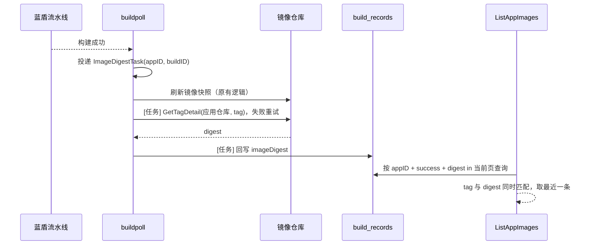

# 制品镜像关联构建源材料（分支 / Tag + CommitID）

TAPD：[平台构建的镜像能关联 git 的分支+commitid](https://tapd.woa.com/tapd_fe/70165342/story/detail/1070165342139094750)

## 背景

制品管理页（应用镜像列表 `GET /apps/{appID}/images`）需要新增「源材料」列：平台构建的镜像展示构建所用的分支或 Tag，以及 Commit（可点击跳转仓库提交页）；从镜像仓库同步、没有平台构建信息的镜像展示 `--`。

改造前两侧数据是割裂的：

- 镜像列表的数据来自镜像快照 `snapshot.Image`，只有 tag、digest、大小、构建时间，不含任何代码信息。
- 构建记录 `build_records` 已有完整代码信息：`Params` 中的仓库地址、检出方式、修订值，`Extras` 中蓝盾回写的仓库地址与实际检出的 CommitID。构建管理页的「源材料」列就是用它展示的。

因此核心问题是：**如何把一个镜像准确地对应到产出它的那条构建记录。**

## 关联方式：tag + digest 精确匹配

只按 tag 关联不可靠：

- 同名 tag 可能被重复构建覆盖，同一 tag 对应多条构建记录。
- 平台构建后，同名 tag 可能被外部推送覆盖，此时按 tag 会展示错误的 commit。

镜像 digest 唯一标识镜像内容，能区分以上情况。但构建记录原本不存 digest，蓝盾推送插件 `DockerBuildAndPushImage` 的输出变量也不含 digest，所以由后端在构建成功时自行读取。

### 写入：构建成功时记录 digest

构建状态轮询（`buildpoll`）发现构建成功后，投递一个以 `appID + buildID` 为参数的 asynq 任务 `ImageDigestTask`，再照常异步刷新镜像快照。任务持久化在 Redis 中，服务重启不会丢失。任务执行时：

1. 按 `appID + buildID` 重新读取构建记录。记录不存在则停止重试；状态不是成功或已记录过 digest 则直接结束，保证重复投递与重试幂等。
2. 构建结束超过 `imageDigestRecordWindow`（5 分钟）则放弃，不读镜像仓库。
3. 取构建参数中的镜像 tag，为空则跳过。
4. 解析应用的制品仓库（与镜像快照使用同一套 `ResolveRepoKeyForApp`）。构建产物 `Artifact` 不在该仓库时跳过：这类镜像不会出现在制品列表中，仓库凭证也不一定适用。
5. 使用与快照同步相同的 `registry.Client.GetTagDetail` 读取 digest，保证与快照中的 digest 含义一致（多架构镜像同样一致）。
6. 回写构建记录新字段 `imageDigest`（`UpdateRecordImageDigest`）。

失败按 asynq 默认退避最多重试 3 次，全部重试都落在 5 分钟窗口内。重试耗尽、超出窗口或投递失败时只打日志，不影响构建结果与快照刷新，该记录 digest 为空，列表展示 `--`。

不从快照详情同步反向补写：那是从镜像出发猜「哪条构建产出了它」，读取时间不受控，tag 被覆盖后会把外部镜像的 digest 写到构建记录上。本任务从 `buildID` 出发，只会写入产出方自己。

窗口要有上限：digest 是按 tag 回查的，越晚读越可能读到被覆盖后的镜像（例如 worker 停机后积压的任务）。超出窗口宁可展示 `--`，也不关联到错误的构建。

### 读取：列表按 tag + digest 关联

`ListAppImages` 拿到当前页镜像快照后，调用 `LatestSucceededRecordsByImages`，传入 tag → digest 映射，一次查询本应用中 `status=success` 且 `imageDigest` 命中的构建记录（按结束时间倒序），在内存中按 tag 与 digest **同时相等**筛选，每个 tag 取最近结束的一条。

必须同时匹配 tag：构建缓存全部命中时，不同 tag 的两次构建可能产出相同 digest，只比 digest 会把 `v2` 的镜像串到 `v1` 的构建记录上。

### 已知边界

- digest 是构建结束后按 tag 回查的，不是构建产物本身给出的。从镜像推送完成到读取之间存在窗口：最长约一个轮询间隔，加上重试的退避时间，上限为构建结束后 5 分钟。窗口内若有外部推送覆盖同名 tag，会记成覆盖后的 digest，列表将外部镜像展示为这次构建的源材料。根治需要流水线在构建时带出 digest 或可校验的构建标识，本次未做。
- 刚构建完的镜像，要等镜像快照同步到 digest 后才能关联上。
- 应用切换制品仓库后，旧仓库构建记录的 digest 不会与新仓库的镜像匹配，展示 `--`，符合预期。

## 接口变更

`AppImageOutputObj` 新增可为空的 `sourceMaterial` 字段，无法关联时为 `null`：

| 字段 | 说明 |
|---|---|
| `revisionType` | `branch` / `tag` / `commit`，由构建参数中的检出方式还原 |
| `revision` | 分支名、Tag 名或 CommitID，按构建时填写的原样返回 |
| `commitID` | 实际检出的完整 CommitID |
| `repoURL` | 代码仓库地址，优先取流水线实际检出的仓库，缺失时回退到构建配置的仓库 |
| `commitURL` | 后端拼好的提交页地址 `{仓库地址去掉 .git}/commit/{commitID}`，仓库地址不是 http(s) 时为空 |

展示约定（前端实现）：`revisionType=commit` 时只展示 commit；其余情况展示「分支图标 + 修订值 + commit 图标 + 8 位短哈希」，与构建管理页一致。

## 已确认的取舍

| 问题 | 结论 |
|---|---|
| 历史构建记录没有 digest | 展示 `--`，不回退到按 tag 模糊匹配 |
| 按 CommitID 构建的展示 | 按原型只展示 commit，由前端处理 |
| 自定义流水线构建 | 仓库地址和 CommitID 都有值才返回源材料，否则为 `null` |
| 关键字搜索 | 仍只按 tag 搜索，不支持按分支 / commit 搜索 |
| 范围 | 只改应用制品列表接口，可部署 tag 选择器等其他接口不变；本次只改后端 |

## 存储与索引

- `build_records` 新增 `imageDigest` 字段（`omitempty`），无需数据迁移，历史记录为空即可。
- 未新增索引：查询条件以 `appID` 开头，现有唯一索引 `appID + buildID` 的前缀即可支撑，单个应用的构建记录量有限。

## 代码改动

| 文件 | 改动 |
|---|---|
| `pkg/build/image/record.go` | `Record` 新增 `ImageDigest` |
| `pkg/build/image/store.go` | 新增 `UpdateRecordImageDigest`、`LatestSucceededRecordsByImages` |
| `pkg/server/taskqtask/buildpoll/register.go`、`types.go` | 新增任务 `ImageDigestTask` 及参数 `ImageDigestArgs`、重试上限与记录窗口 |
| `pkg/server/taskqtask/buildpoll/common.go` | 新增 `enqueueRecordImageDigest`、任务处理 `recordImageDigestOfBuild` 与 `recordImageDigest` |
| `pkg/server/taskqtask/buildpoll/poll.go` | 构建成功后投递 digest 记录任务，再刷新快照 |
| `pkg/server/taskqtask/task.go` | 挂载 `ImageDigestTask` |
| `pkg/workload/image/serializer/image.go` | 新增 `ImageSourceMaterialOutputObj`、`NewImageSourceMaterial`，`AppImageOutputObj` 新增 `sourceMaterial` |
| `pkg/workload/image/handler/image.go` | `ListAppImages` 关联构建记录并输出源材料 |
| `docs/apis/*` | `make apidocs` 重新生成 |

## 测试

- `pkg/build/image/store_test.go`：digest 回写；tag + digest 同时匹配取最近一条；同 digest 不同 tag 不串号；tag 被外部覆盖不匹配；快照 digest 为空不匹配。
- `pkg/server/taskqtask/buildpoll/poll_test.go`：成功构建投递 digest 任务、投递失败仍刷新快照、失败构建不投递；`recordImageDigestOfBuild` 的窗口内记录、已记录跳过、非成功跳过、超出窗口停止重试、记录缺失停止重试、记录失败可重试；`recordImageDigest` 的正常记录、仓库不一致跳过、tag 为空跳过、镜像仓库报错。
- `pkg/workload/image/serializer/image_test.go`：各检出方式的源材料生成、仓库地址回退、缺少 CommitID 返回 `null`、非 http(s) 仓库不生成链接。
