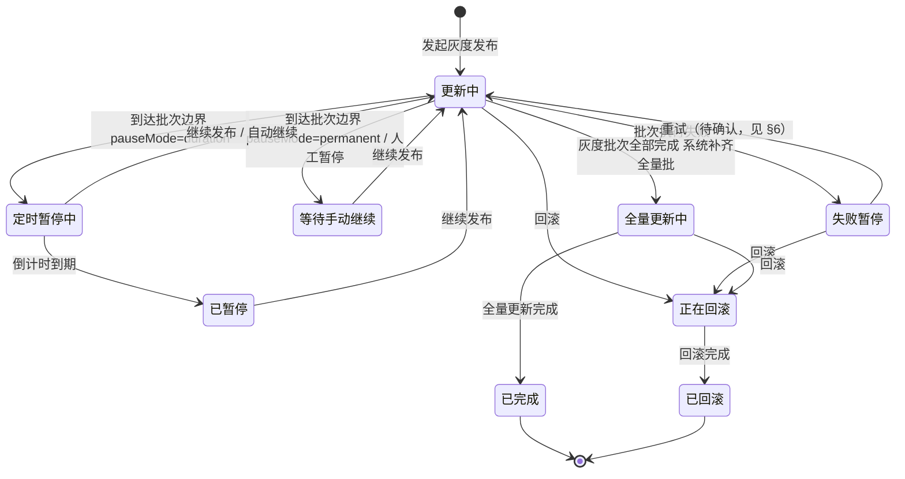

# 灰度发布进度面板状态方案

> 依据：8 张设计图（其中 1 张重复，实际 7 个状态）+ 设计稿未覆盖但现状保留的 2 个回滚态。
> 本文档是「灰度发布进度面板」状态展示口径的唯一事实源，用于指导代码对齐与测试更新。
>
> 关联代码：
> - `src/pages/application/detail/deploy/instance-list/batch-release.ts`（纯函数层：`resolveBatchReleaseBanner` / `buildBatchReleaseSteps` / `resolvePausedStepTag`）
> - `src/pages/application/detail/deploy/instance-list/components/batch-release-progress-panel.vue`（进度大横幅：`statusText` / `hintTag` / 元信息 / `curStep` / `flatActions`）
> - `src/pages/application/detail/deploy/instance-list/components/batch-release-banner.vue`（单行横幅，共用 view 模型）
>
> 关联测试：`test/batch-release-banner.test.ts`、`test/scenarios/batch-release-control.test.ts`

---

## 1. 状态判定规则

状态 = f(`status` × `batchPhase` × `currentBatchIndex` × 倒计时余量)。

| # | 状态名 | 判定条件（按优先级从上到下） |
|---|--------|------------------------------|
| S1 | 更新中（普通批） | `status=deploying` 且 `batchPhase ∈ {pending, updating}` |
| S2 | 等待手动继续 | `status=deploying` 且 `batchPhase=manual-paused`（策略永久暂停 / 人工暂停） |
| S3 | 定时暂停中 | `status=deploying` 且 `batchPhase=timed-paused` 且剩余秒数 > 0（`pauseStartTime + pauseSeconds` 换算） |
| S4 | 已暂停 | `status=deploying` 且 `batchPhase=timed-paused` 且倒计时已到期（换算不出剩余时间也归入 S4，不再兜底为「等待手动继续」） |
| S5 | 失败暂停 | `status=failed` |
| S6 | 全量更新中 | `status=deploying` 且当前批为系统补齐全量批（`currentBatchIndex` 越过灰度批数，即 `currentIdx >= batches.length`），或 `batchPhase=completed` |
| S7 | 已完成 | `status=deployed` |
| S8 | 正在回滚（保留态） | `status=deploying` 且 `currentBatchIndex=-1` |
| S9 | 已回滚（保留态） | `status=rolled-back` |

> 说明：
> - `currentBatchIndex` 可能为 `null`（尚未进入批次），此时按 S1（更新中）处理，按钮门控只看 `batchPhase`，不看批次序号。
> - S3/S4 的拆分是本次设计稿新增的口径：现状里 timed-paused 到期统一展示「等待手动继续」，需改为「已暂停」。

### 状态流转图

---

## 2. 九态总览

| # | 状态 | 标题文本 | 标题 Tag | 按钮 | 可关闭 | 横幅配色 |
|---|------|----------|----------|------|--------|----------|
| S1 | 更新中（普通批） | 灰度发布中 | 正在更新实例（info） | 暂停、回滚 | 否 | 蓝 |
| S2 | 等待手动继续 | 灰度发布中 | 等待手动继续（warning） | 继续发布、回退上一批（第 1 批置灰）、跳过剩余批次、回滚 | 否 | 橙 |
| S3 | 定时暂停中 | 灰度发布中 | 定时暂停中 · mm:ss 后自动继续（warning，逐秒倒计时）；步骤 Tag 为「暂停中 mm:ss」 | 继续发布、暂停、跳过剩余批次、回滚 | 否 | 橙 |
| S4 | 已暂停 | 灰度发布中 | 已暂停（warning） | 继续发布、回退上一批、跳过剩余批次、回滚 | 否 | 橙 |
| S5 | 失败暂停 | 灰度发布中 | 失败（danger） | 回退上一批、回滚（重试待确认，见 §6） | 否 | 红 |
| S6 | 全量更新中 | 灰度发布中 | 正在全量更新（info） | 无 | 否 | 蓝 |
| S7 | 已完成 | 灰度发布已完成 | 已完成（success） | 无 | 是 | 绿 |
| S8 | 正在回滚（保留） | 正在回滚 | 正在清理灰度资源（info） | 无 | 否 | 蓝 |
| S9 | 已回滚（保留） | 已回滚 | —（设计稿未覆盖） | 无 | 是 | 橙 |

---

## 3. 七态详情矩阵

### 3.1 共性元信息行

所有状态的元信息行结构一致，仅部分字段按状态显示/隐藏：

| 字段 | 显示条件 | 说明 |
|------|----------|------|
| 失败原因 | 仅 S5 | 取 `progress.message`，超长截断 + tooltip |
| 发布策略 | `strategyName` 非空 | 策略名称 |
| 共 N 批 | 始终 | 含系统补齐全量批 |
| 当前 第 N 批 / 全量 / 已完成 | 非终态；S7 显示「已完成」；S8/S9 隐藏 | |
| 已更新 x/y 个实例 | 始终 | |
| 镜像 旧 → 新 | 始终；S8/S9 反向显示 新 → 旧 | |
| 开始时间 `MM-DD HH:mm` | **设计稿新增，接口缺字段（见 §6 待确认）** | |
| 已耗时 / 总耗时 | **设计稿新增，接口缺字段（见 §6 待确认）；S7 显示总耗时** | |

按钮排列顺序（`flatActions`）：主操作（继续发布/暂停）→ 回退上一批 / 跳过剩余批次 → 回滚。

### 3.2 S1 更新中（普通批）

- **标题**：灰度发布中
- **标题 Tag**：`正在更新实例`（info，蓝）
- **按钮**：`暂停`（default）→ `回滚`（danger，二次确认）
- **批次步骤**：当前批 Tag=`正在更新`（info，节点 loading）；后续批=`未开始`（default）；已过批=`已完成`（success）
- **curStep**：当前批序号（未进入批次时为 1）

### 3.3 S2 等待手动继续（manual-paused）

- **标题**：灰度发布中
- **标题 Tag**：`等待手动继续`（warning，橙）
- **按钮**：`继续发布`（primary）→ `回退上一批`（default，第 1 批置灰 disabled）→ `跳过剩余批次`（default，二次确认）→ `回滚`（danger，二次确认）
- **批次步骤**：当前批 Tag=`等待手动继续`（warning）；副文本=当前批的暂停方式（如「永久暂停 · 手动继续」）
- **curStep**：当前批序号

### 3.4 S3 定时暂停中（timed-paused，倒计时未到期）

- **标题**：灰度发布中
- **标题 Tag**：`暂停中 00:18`（warning，橙；mm:ss 格式，随 5s 轮询刷新）
- **按钮**：`继续发布`（primary）→ `暂停`（default，**本次新增**：提前进入手动暂停）→ `跳过剩余批次`（default，二次确认）→ `回滚`（danger，二次确认）
- **批次步骤**：当前批 Tag=`暂停中 mm:ss`（warning）；副文本=「暂停 N 秒 · 自动继续」
- **curStep**：当前批序号

### 3.5 S4 已暂停（timed-paused，倒计时已到期）

- **标题**：灰度发布中
- **标题 Tag**：`已暂停`（warning，橙）
- **按钮**：`继续发布`（primary）→ `回退上一批`（default）→ `跳过剩余批次`（default，二次确认）→ `回滚`（danger，二次确认）
- **批次步骤**：当前批 Tag=`已暂停`（warning）
- **curStep**：当前批序号

> S3 与 S4 是同一 batchPhase 的两个子态，以倒计时余量区分；S4 不再有「暂停」按钮（已经暂停），恢复「回退上一批」。

### 3.6 S5 失败暂停（failed）

- **标题**：灰度发布中
- **标题 Tag**：`失败`（danger，红）
- **按钮**：`回退上一批`（default，二次确认）→ `回滚`（danger，二次确认）。设计图中无「重试」，是否保留见 §6
- **元信息**：额外显示「失败原因」
- **批次步骤**：失败批 Tag=`失败`（danger，节点 error）；失败批之前=`已完成`（success）；之后=`未开始`（default）
- **curStep**：失败批序号

### 3.7 S6 全量更新中

- **标题**：灰度发布中
- **标题 Tag**：`正在全量更新`（info，蓝；**区别于 S1 的「正在更新实例」**）
- **按钮**：无（系统补齐全量批阶段不提供任何操作，避免干扰自动收尾）
- **批次步骤**：全量批 Tag=`正在更新`（info，节点 loading）；之前所有批=`已完成`（success）
- **curStep**：最后一节点（全量批序号）

### 3.8 S7 已完成（deployed）

- **标题**：灰度发布已完成
- **标题 Tag**：`已完成`（success，绿）
- **按钮**：无；可关闭（关闭记忆按 deployID，下次发布重新出现）
- **元信息**：「当前」显示为已完成；耗时显示总耗时（如「总耗时 32 分 05 秒」）
- **批次步骤**：全部节点 Tag=`已完成`（success，stepStatus=done）
- **curStep**：**总批数 + 1**（见 §4）

---

## 4. 步骤条 curStep 规则

bkui Steps 的 `curStep` 从 1 开始，指向「当前节点」。

| 状态 | curStep | 说明 |
|------|---------|------|
| S1 更新中（未进入批次） | 1 | |
| S1 更新中（已进入批次） | 当前批序号 | |
| S2/S3/S4 暂停态 | 当前批序号 | 节点保留数字高亮，Tag 表达暂停 |
| S5 失败 | 失败批序号 | 节点 error |
| S6 全量更新中 | 全量批序号（最后一节点） | |
| S7 已完成 | **总批数 + 1**（`steps.length + 1`） | curStep 越过最后一个节点，配合全部节点 `done`，表达「所有步骤都已完成」，避免最后一批被高亮为当前步骤 |
| S8/S9 回滚态 | 总批数 + 1 | S8 按 Figma（2160-44641）为蓝色系过程态；批次级「回滚中/已取消」区分缺接口字段（见 §7-6） |

> 现状偏差：`batch-release-progress-panel.vue` 中 `curStep = Math.min(props.view.batchIndex ?? 1, stepsData.length)`，
> deployed 时 `batchIndex=null` 导致 `curStep=1`，第一步被误当作当前步骤，需按上表修正。

---

## 5. Tag 配色规范

### 5.1 标题 Tag 全集（7 种）

| Tag | 主题 | 背景 / 文字色 |
|-----|------|---------------|
| 正在更新实例 | info | `#E1ECFF` / `#3A84FF` |
| 正在全量更新 | info | `#E1ECFF` / `#3A84FF` |
| 等待手动继续 | warning | `#FDEED8` / `#F59500` |
| 暂停中 mm:ss | warning | `#FDEED8` / `#F59500` |
| 已暂停 | warning | `#FDEED8` / `#F59500` |
| 失败 | danger | `#FFEBEB` / `#EA3636` |
| 已完成 | success | `#E5F6EA` / `#2CAF5E` |

### 5.2 步骤 Tag 全集

| Tag | 主题 | 备注 |
|-----|------|------|
| 未开始 | default | `#F0F1F5` / `#63656E` |
| 正在更新 | info | 节点 loading 图标 |
| 已完成 | success | |
| 等待手动继续 | warning | manual-paused |
| 暂停中 mm:ss | warning | timed-paused 未到期，随轮询刷新 |
| 已暂停 | warning | timed-paused 已到期 |
| 失败 | danger | 现状为「更新失败」，按设计稿改为「失败」 |

---

## 6. 现状差异与对齐清单

映射到具体函数改动点，按优先级排列：

| # | 差异 | 现状 | 目标 | 改动位置 | 受影响测试 |
|---|------|------|------|----------|------------|
| ① | 标题统一 | 失败/暂停标题为「第 N 批失败」「第 N 批已暂停」 | 统一为「灰度发布中」，批次信息由元信息行与步骤条承载 | `batch-release-progress-panel.vue` `statusText` | `test/batch-release-banner.test.ts` |
| ② | 标题 Tag 七态化 | `failed`/`completed` 无 Tag；S6 全量更新中仍显示「正在更新实例」；timed-paused 到期显示「等待手动继续」 | 补齐 S5「失败」、S7「已完成」、S6「正在全量更新」、S4「已暂停」；倒计时改 mm:ss | `hintTag` computed；建议把 Tag 收敛进 `resolveBatchReleaseBanner` 纯函数层（新增 `statusTag` 字段），组件只渲染 | `test/batch-release-banner.test.ts`、`test/scenarios/batch-release-control.test.ts` |
| ③ | timed-paused 新增「暂停」按钮 | 暂停态按钮只有 `继续发布 + 回滚` | S3 增加 `暂停`（default），提前进入手动暂停；S4 无此按钮 | `batch-release.ts` `resolveBatchReleaseBanner` 暂停分支；action `pause` 已存在，需确认后端 operateBatchRelease 支持在 timed-paused 阶段下发 pause | `test/scenarios/batch-release-control.test.ts` |
| ④ | 失败态按钮 | `重试`（continue）+ `回滚` | 设计图为 `回退上一批 + 回滚`（无重试），待确认 | `resolveBatchReleaseBanner` failed 分支 | `test/scenarios/batch-release-control.test.ts` |
| ⑤ | 全量更新中无按钮 | batchPhase=completed 时 actions 已为空 | 维持无按钮，仅标题 Tag 改为「正在全量更新」 | `hintTag` | `test/batch-release-banner.test.ts` |
| ⑥ | 步骤失败 Tag 文案 | 「更新失败」 | 「失败」 | `batch-release.ts` `buildBatchReleaseSteps` | `test/scenarios/batch-release-control.test.ts` |
| ⑦ | 第 1 批「回退上一批」 | 直接不渲染 | 显示且置灰（disabled，点击拦截），表达「存在但不可用」 | `resolveBatchReleaseBanner`：`overflowActions` 中 backward 改为 `createAction('backward','default',{confirm:BACKWARD_CONFIRM,disabled:true})`（`disabled` 的操作不会收进「更多」，需平铺展示，注意 `flatActions` 与渲染层适配） | `test/scenarios/batch-release-control.test.ts` |
| ⑧ | 元信息开始时间/耗时 | 接口 `BatchReleaseProgressOutputObj` 无 `startTime`/耗时字段 | 前端按设计稿展示开始时间与已耗时/总耗时 | 需后端补字段；前端在字段就绪前隐藏对应元信息项（现有「仅展示有数据支撑的字段」策略可直接复用） | 新增用例 |
| ⑨ | deployed curStep | `curStep = Math.min(batchIndex ?? 1, steps.length)` → completed 时为 1 | `steps.length + 1` | `batch-release-progress-panel.vue` `curStep` computed | `test/batch-release-banner.test.ts` |
| ⑩ | S4 已暂停区分 | timed-paused 到期统一「等待手动继续」 | 到期显示「已暂停」，且按钮集合从 S3 切到 S4（恢复「回退上一批」、去掉「暂停」） | `resolvePausedStepTag` 返回值 + banner 层按剩余时间拆分按钮集合 | `test/scenarios/batch-release-control.test.ts` |

> 实施建议：标题 Tag（②）、S3/S4 拆分（⑩）、失败按钮（④）都属于「接口字段 → 展示模型」的收敛，应全部下沉到 `batch-release.ts` 纯函数层（view 模型增加 `statusTag` 等字段），组件层保持纯渲染，测试继续打在纯函数层。

---

## 7. 待确认项

1. **开始时间 / 耗时接口字段**：设计稿元信息含「开始时间 10-12 14:30」「已耗时/总耗时」，`BatchReleaseProgressOutputObj` 无对应字段。需后端在进度接口补充（建议 `startTime`、`elapsedSeconds` / `totalDurationSeconds`），前端在字段就绪前隐藏。
2. **S3 的「暂停」按钮语义**：点击后预期把 timed-paused 转为 manual-paused（放弃自动继续）。需与后端确认 `operateBatchRelease(action=pause)` 是否支持在 timed-paused 阶段下发，以及暂停后剩余倒计时作废的口径。
3. **S5 失败态是否保留「重试」**：设计图只有「回退上一批 + 回滚」。若失败后不允许重试，需后端确认；若保留，按钮集合为「重试 + 回退上一批 + 回滚」。
4. **S3 是否展示「回退上一批」**：设计图③无此按钮（不确定是否因处于第 1 批）。建议规则与 S4 对齐：非第 1 批显示、第 1 批置灰，待设计确认。
5. **S6 全量更新中的回滚风险**：全量批阶段回滚是否允许、是否需要更强的二次确认，设计稿未覆盖（现状无按钮=不允许），建议维持现状并同步设计。
6. **S8/S9 回滚态批次级步骤**：Figma（2160-44641）已覆盖 S8——蓝色容器（`#F0F5FF`/`#A3C5FD`）、标题 Tag「正在清理灰度资源」、步骤条中回滚批为 loading+「回滚中」、未执行批为灰 Tag「已取消」；S9 仍未覆盖。已落地容器配色与标题 Tag；步骤的批次级区分依赖接口给出回滚批次序号（现 `currentBatchIndex=-1` 无批次信息）与每批执行状态，缺字段暂统一展示「已完成」，待后端补充后再对齐。
7. **第 1 批「回退上一批」置灰（⑦）**：置灰按钮是否仍需 tooltip 说明原因，设计稿未标注，建议加「第 1 批没有可回退的上一批」tooltip。
